# ambientCG: Gravel materials

**19 assets from [ambientCG](https://ambientcg.com), dedicated to the public domain under [CC0](https://docs.ambientcg.com/license/).** Use them in any game, free or paid, and change them however you like; no credit is needed.

PBR materials as 1K and 2K JPG maps (colour, normal GL and DX, roughness, AO, displacement), one folder per resolution. 867.0 MB in all.

This is a copy kept by [zuujis-cc0](https://github.com/zuujis-cc0) so game makers can take single files from GitHub. It is not made by or affiliated with ambientCG: the originals, often in more formats and higher resolutions, are on [ambientcg.com](https://ambientcg.com). If they help you, consider [supporting ambientCG](https://www.patreon.com/ambientCG).

Every file is listed in [MANIFEST.tsv](MANIFEST.tsv) with its size and SHA-256. More free assets: [the Zuujis collection](https://github.com/zuujis-cc0/free-game-assets#readme).

| | | | |
| :-: | :-: | :-: | :-: |
| <a href="Gravel021">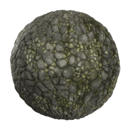</a> <b><a href="Gravel021">Gravel 021</a></b> by ambientCG · <a href="https://ambientcg.com/a/Gravel021">source</a> | <a href="Gravel022">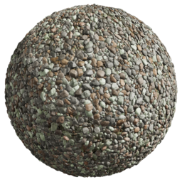</a> <b><a href="Gravel022">Gravel 022</a></b> by ambientCG · <a href="https://ambientcg.com/a/Gravel022">source</a> | <a href="Gravel023">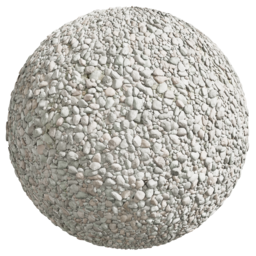</a> <b><a href="Gravel023">Gravel 023</a></b> by ambientCG · <a href="https://ambientcg.com/a/Gravel023">source</a> | <a href="Gravel024">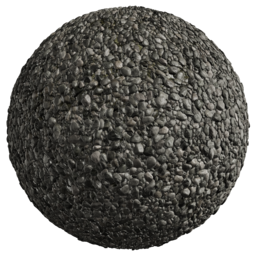</a> <b><a href="Gravel024">Gravel 024</a></b> by ambientCG · <a href="https://ambientcg.com/a/Gravel024">source</a> |
| <a href="Gravel025">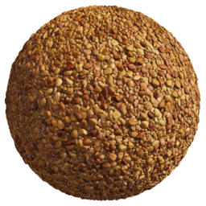</a> <b><a href="Gravel025">Gravel 025</a></b> by ambientCG · <a href="https://ambientcg.com/a/Gravel025">source</a> | <a href="Gravel026">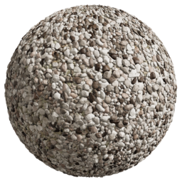</a> <b><a href="Gravel026">Gravel 026</a></b> by ambientCG · <a href="https://ambientcg.com/a/Gravel026">source</a> | <a href="Gravel027">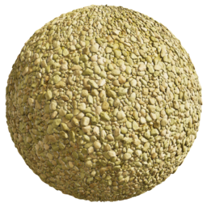</a> <b><a href="Gravel027">Gravel 027</a></b> by ambientCG · <a href="https://ambientcg.com/a/Gravel027">source</a> | <a href="Gravel028">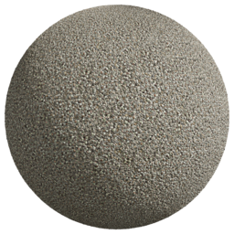</a> <b><a href="Gravel028">Gravel 028</a></b> by ambientCG · <a href="https://ambientcg.com/a/Gravel028">source</a> |
| <a href="Gravel029">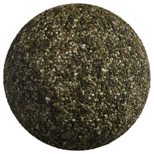</a> <b><a href="Gravel029">Gravel 029</a></b> by ambientCG · <a href="https://ambientcg.com/a/Gravel029">source</a> | <a href="Gravel030">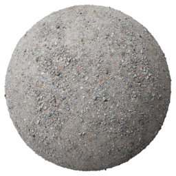</a> <b><a href="Gravel030">Gravel 030</a></b> by ambientCG · <a href="https://ambientcg.com/a/Gravel030">source</a> | <a href="Gravel031">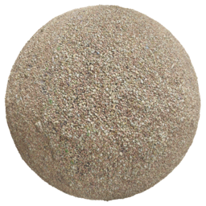</a> <b><a href="Gravel031">Gravel 031</a></b> by ambientCG · <a href="https://ambientcg.com/a/Gravel031">source</a> | <a href="Gravel032">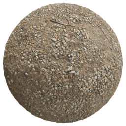</a> <b><a href="Gravel032">Gravel 032</a></b> by ambientCG · <a href="https://ambientcg.com/a/Gravel032">source</a> |
| <a href="Gravel033">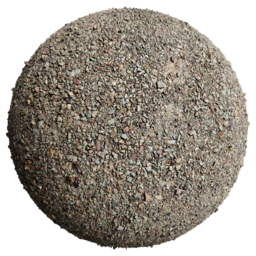</a> <b><a href="Gravel033">Gravel 033</a></b> by ambientCG · <a href="https://ambientcg.com/a/Gravel033">source</a> | <a href="Gravel034">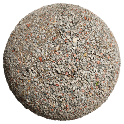</a> <b><a href="Gravel034">Gravel 034</a></b> by ambientCG · <a href="https://ambientcg.com/a/Gravel034">source</a> | <a href="Gravel035">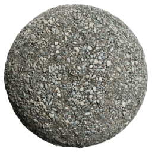</a> <b><a href="Gravel035">Gravel 035</a></b> by ambientCG · <a href="https://ambientcg.com/a/Gravel035">source</a> | <a href="Gravel036L">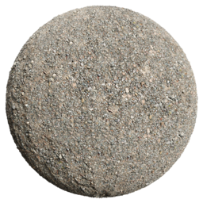</a> <b><a href="Gravel036L">Gravel 036 L</a></b> by ambientCG · <a href="https://ambientcg.com/a/Gravel036L">source</a> |
| <a href="Gravel036S">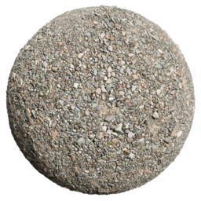</a> <b><a href="Gravel036S">Gravel 036 S</a></b> by ambientCG · <a href="https://ambientcg.com/a/Gravel036S">source</a> | <a href="Gravel037">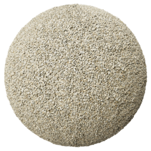</a> <b><a href="Gravel037">Gravel 037</a></b> by ambientCG · <a href="https://ambientcg.com/a/Gravel037">source</a> | <a href="Gravel038">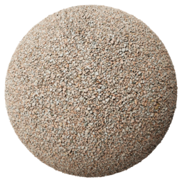</a> <b><a href="Gravel038">Gravel 038</a></b> by ambientCG · <a href="https://ambientcg.com/a/Gravel038">source</a> |  |

---

Kept up to date by this repository's own [update workflow](.github/workflows/update.yml), with code and plan from [cc0-mirror](https://github.com/zuujis-cc0/cc0-mirror). Something wrong? [Open an issue there](https://github.com/zuujis-cc0/cc0-mirror/issues/new) or use the [private report form](https://games.zuujis.com/report).
